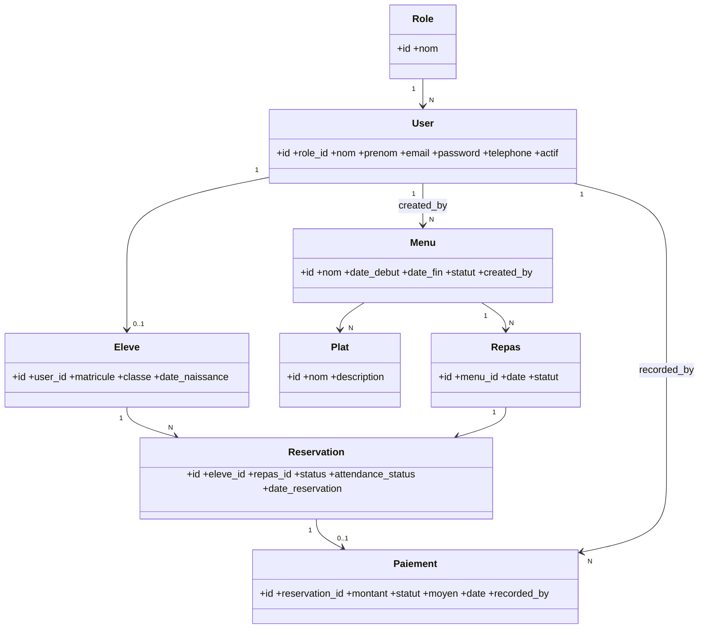

# Madrassati — Technical Architecture & Implementation Specification
**WorldSkills Algeria 2026 — School Cafeteria Meal Management System**
Stack: Laravel · PHP 8+ · MySQL 8 · Blade · Tailwind CSS · vanilla JS

---

## 0. Locked Architectural Decisions (single source of truth)

These decisions are final and apply consistently across every layer below. No alternatives exist elsewhere in this document.

1. **Paiement**: `Reservation 1 ─── 0..1 Paiement`. Manual record only (`montant`, `statut`: payé/impayé/exonéré, `moyen`: espèces/carte_cantine, `date`). No gateway, no external API. Created/edited only by Administrateur and Gestionnaire, after a reservation exists. `montant` is entered manually at payment time — no automatic pricing engine on Menu/Plat/Repas.
2. **Status separation**:
   - `reservation.status`: `en_attente | confirmee | annulee`
   - `reservation.attendance_status`: `non_verifiee | present | absent`
   - `repas.statut`: `planifie | servi`
   - On creation, a reservation is set directly to `confirmee` (self-service booking, no manual approval step exists in the functional requirements). `en_attente` remains a valid schema value but is not entered by any implemented transition in v1. `annulee` is set on cancellation (student, within the edit window, or staff at any time).
3. **Duplicate prevention**: `UNIQUE(eleve_id, repas_id)` on `reservations`, enforced at MySQL level **and** in the `StoreReservationRequest`/`UpdateReservationRequest` validation.
4. **Repas generation**: A `Repas` is never created manually. Publishing a `Menu` (`statut` → `publie`) automatically generates one `Repas` row per calendar date in `[date_debut, date_fin]`, each `statut = planifie`. This is what "publier menu hebdomadaire" produces, and it is what reservations attach to.
5. **Controllers**: One controller per domain resource — `UserController`, `RoleController`, `StudentController`, `MenuController`, `PlatController`, `ReservationController`, `RepasController`, `PaiementController`, `DashboardController`, `StatisticsController`. No `AdminController`/`GestionnaireController`/`EleveController`. Role scoping happens inside each controller (query scoping) and through Middleware/Policies — never through duplicated controllers.
6. **Consistency**: UML → Database → Models → Controllers → Requests → Policies/Middleware → Routes → Blade → Tests all describe the same nine entities and the same rules. Nothing below introduces an entity, field, or route not listed here.

---

## 1. System Architecture

Monolithic server-rendered Laravel MVC application. No SPA, no API layer, no queues, no external services — appropriate for the 15-hour competition scope.

```
Browser (Blade + Tailwind + minimal vanilla JS)
      │  HTTPS
      ▼
routes/web.php
      │
      ▼
Middleware  →  auth (session guard)  →  role:<roles>  (custom RoleMiddleware)
      │
      ▼
Controller (thin) → Form Request (validation) → Policy (authorization)
      │
      ▼
Eloquent Models  →  MySQL 8 (InnoDB, foreign keys, UNIQUE/CHECK constraints)
      │
      ▼
Blade view (resources/views/...)  →  HTML response
```

- Session-based authentication (Laravel default `web` guard), CSRF-protected forms.
- 3 logical layers: Presentation (Blade), Application (Controllers/Requests/Policies), Data (Eloquent/MySQL).
- Services are used only where logic is reused across controllers (menu publishing / repas generation, attendance validation) — see §6.

---

## 2. Feature / Module Structure

| Module | Owner controller(s) | Roles with access |
|---|---|---|
| Authentication | `AuthController` | all (public login) |
| Users & Roles | `UserController`, `RoleController` | Administrateur |
| Students | `StudentController` | Administrateur (full), Gestionnaire (read-only) |
| Menus & Plats | `MenuController`, `PlatController` | Administrateur, Gestionnaire (manage); Élève (read published only) |
| Repas (meal instances) | `RepasController` | Administrateur, Gestionnaire |
| Reservations | `ReservationController` | Élève (own), Administrateur/Gestionnaire (all + attendance) |
| Paiements | `PaiementController` | Administrateur, Gestionnaire |
| Dashboard | `DashboardController` | all (role-aware content) |
| Statistics | `StatisticsController` | Administrateur, Gestionnaire |
| Search / Filters | embedded in each `index()` via query-string params | role-appropriate scope |

---

## 3. Role / Permission Matrix

| Feature | Administrateur | Gestionnaire | Élève |
|---|:---:|:---:|:---:|
| Login/logout | ✔ | ✔ | ✔ |
| Manage users (CRUD + role assignment) | ✔ | ✘ | ✘ |
| View roles list | ✔ | ✘ | ✘ |
| Students: create/update/delete | ✔ | ✘ | ✘ |
| Students: list/search/view | ✔ | ✔ | ✘ |
| Menus: create/update/delete/publish | ✔ | ✔ | ✘ |
| Menus: view published | ✔ | ✔ | ✔ |
| Plats: CRUD | ✔ | ✔ | ✘ |
| Repas: list/view | ✔ | ✔ | ✘ (sees repas only nested inside a published menu) |
| Repas: mark served | ✔ | ✔ | ✘ |
| Reservations: create/edit/cancel own | ✘ | ✘ | ✔ |
| Reservations: view all / search | ✔ | ✔ | ✘ (own only) |
| Reservations: validate attendance | ✔ | ✔ | ✘ |
| Paiements: create/update/view | ✔ | ✔ | ✘ |
| Dashboard | ✔ (global) | ✔ (global) | ✔ (own reservations only) |
| Statistics | ✔ | ✔ | ✘ |

---

## 4. Database Schema

### 4.1 Entity-Relationship Diagram



### 4.2 Table Definitions

#### `roles`
| Column | Type | Constraints |
|---|---|---|
| id | BIGINT UNSIGNED | PK, AUTO_INCREMENT |
| nom | VARCHAR(30) | NOT NULL, UNIQUE — values: `administrateur`, `gestionnaire`, `eleve` |
| created_at, updated_at | TIMESTAMP | NULL |

#### `users`
| Column | Type | Constraints |
|---|---|---|
| id | BIGINT UNSIGNED | PK, AUTO_INCREMENT |
| role_id | BIGINT UNSIGNED | NOT NULL, FK → `roles.id` ON UPDATE CASCADE ON DELETE RESTRICT |
| nom | VARCHAR(100) | NOT NULL |
| prenom | VARCHAR(100) | NOT NULL |
| email | VARCHAR(150) | NOT NULL, UNIQUE |
| password | VARCHAR(255) | NOT NULL (bcrypt) |
| telephone | VARCHAR(20) | NULL |
| actif | TINYINT(1) | NOT NULL DEFAULT 1 |
| remember_token | VARCHAR(100) | NULL |
| created_at, updated_at | TIMESTAMP | NULL |
| deleted_at | TIMESTAMP | NULL (soft delete) |

Index: `idx_users_role_id (role_id)`.

#### `eleves`
| Column | Type | Constraints |
|---|---|---|
| id | BIGINT UNSIGNED | PK, AUTO_INCREMENT |
| user_id | BIGINT UNSIGNED | NOT NULL, UNIQUE, FK → `users.id` ON UPDATE CASCADE ON DELETE CASCADE |
| matricule | VARCHAR(30) | NOT NULL, UNIQUE |
| classe | VARCHAR(50) | NOT NULL |
| date_naissance | DATE | NULL |
| created_at, updated_at | TIMESTAMP | NULL |
| deleted_at | TIMESTAMP | NULL (soft delete) |

Index: `idx_eleves_classe (classe)`.

#### `menus`
| Column | Type | Constraints |
|---|---|---|
| id | BIGINT UNSIGNED | PK, AUTO_INCREMENT |
| nom | VARCHAR(150) | NOT NULL |
| date_debut | DATE | NOT NULL |
| date_fin | DATE | NOT NULL |
| statut | ENUM('brouillon','publie') | NOT NULL DEFAULT 'brouillon' |
| created_by | BIGINT UNSIGNED | NOT NULL, FK → `users.id` ON UPDATE CASCADE ON DELETE RESTRICT |
| created_at, updated_at | TIMESTAMP | NULL |

Constraints/Indexes: `CHECK (date_fin >= date_debut)`, `idx_menus_statut (statut)`, `idx_menus_dates (date_debut, date_fin)`.

#### `plats`
| Column | Type | Constraints |
|---|---|---|
| id | BIGINT UNSIGNED | PK, AUTO_INCREMENT |
| nom | VARCHAR(150) | NOT NULL |
| description | TEXT | NULL |
| created_at, updated_at | TIMESTAMP | NULL |

#### `menu_plat` (pivot)
| Column | Type | Constraints |
|---|---|---|
| menu_id | BIGINT UNSIGNED | NOT NULL, FK → `menus.id` ON DELETE CASCADE |
| plat_id | BIGINT UNSIGNED | NOT NULL, FK → `plats.id` ON DELETE RESTRICT |

PK: `(menu_id, plat_id)`.

#### `repas`
| Column | Type | Constraints |
|---|---|---|
| id | BIGINT UNSIGNED | PK, AUTO_INCREMENT |
| menu_id | BIGINT UNSIGNED | NOT NULL, FK → `menus.id` ON UPDATE CASCADE ON DELETE RESTRICT |
| date | DATE | NOT NULL |
| statut | ENUM('planifie','servi') | NOT NULL DEFAULT 'planifie' |
| created_at, updated_at | TIMESTAMP | NULL |

Constraints/Indexes: `UNIQUE uniq_repas_menu_date (menu_id, date)`, `idx_repas_statut (statut)`, `idx_repas_date (date)`.

#### `reservations`
| Column | Type | Constraints |
|---|---|---|
| id | BIGINT UNSIGNED | PK, AUTO_INCREMENT |
| eleve_id | BIGINT UNSIGNED | NOT NULL, FK → `eleves.id` ON UPDATE CASCADE ON DELETE RESTRICT |
| repas_id | BIGINT UNSIGNED | NOT NULL, FK → `repas.id` ON UPDATE CASCADE ON DELETE RESTRICT |
| status | ENUM('en_attente','confirmee','annulee') | NOT NULL DEFAULT 'confirmee' |
| attendance_status | ENUM('non_verifiee','present','absent') | NOT NULL DEFAULT 'non_verifiee' |
| date_reservation | TIMESTAMP | NOT NULL DEFAULT CURRENT_TIMESTAMP |
| created_at, updated_at | TIMESTAMP | NULL |

Constraints/Indexes: `UNIQUE uniq_reservation_eleve_repas (eleve_id, repas_id)`, `idx_reservations_status (status)`, `idx_reservations_attendance (attendance_status)`.

#### `paiements`
| Column | Type | Constraints |
|---|---|---|
| id | BIGINT UNSIGNED | PK, AUTO_INCREMENT |
| reservation_id | BIGINT UNSIGNED | NOT NULL, UNIQUE, FK → `reservations.id` ON UPDATE CASCADE ON DELETE CASCADE |
| montant | DECIMAL(8,2) | NOT NULL |
| statut | ENUM('paye','impaye','exonere') | NOT NULL DEFAULT 'impaye' |
| moyen | ENUM('especes','carte_cantine') | NULL (required only when `statut = paye`) |
| date | DATE | NULL |
| recorded_by | BIGINT UNSIGNED | NOT NULL, FK → `users.id` ON UPDATE CASCADE ON DELETE RESTRICT |
| created_at, updated_at | TIMESTAMP | NULL |

Index: `idx_paiements_statut (statut)`.

### 4.3 Relationships / Cardinalities Summary

- Role (1) — (N) User
- User (1) — (0..1) Eleve
- User (1) — (N) Menu *(created_by)*
- User (1) — (N) Paiement *(recorded_by)*
- Menu (N) — (N) Plat *(via `menu_plat`)*
- Menu (1) — (N) Repas
- Eleve (1) — (N) Reservation
- Repas (1) — (N) Reservation
- Reservation (1) — (0..1) Paiement

### 4.4 Integrity Guarantees

- Duplicate reservations impossible: `UNIQUE(eleve_id, repas_id)`.
- Invalid references impossible: every FK is `NOT NULL` (except the inherently optional Paiement, which is its own row keyed by a unique FK) and enforced by InnoDB.
- Deleting an `eleve`/`repas`/`menu`/`plat` that still has dependent `reservations`/`repas`/`menu_plat` rows is blocked (`RESTRICT`) — history is never silently lost.
- `users` and `eleves` use soft deletes so "Supprimer élève/utilisateur" never breaks historical reservation/paiement data.
- Deleting a `reservation` cascades to its `paiement` (a payment cannot exist without its reservation).

---

## 5. Laravel Models & Relationships

| Model | Table | Key relationships | Notes |
|---|---|---|---|
| `Role` | roles | `hasMany(User::class)` | seeded, read-only in app |
| `User` | users | `belongsTo(Role::class)`, `hasOne(Eleve::class)`, `hasMany(Menu::class,'created_by')`, `hasMany(Paiement::class,'recorded_by')` | `Authenticatable`, `SoftDeletes`; `$fillable = [nom,prenom,email,password,telephone,actif,role_id]`; `password` hashed cast |
| `Eleve` | eleves | `belongsTo(User::class)`, `hasMany(Reservation::class)` | `SoftDeletes`; `$fillable = [user_id,matricule,classe,date_naissance]` |
| `Menu` | menus | `belongsTo(User::class,'created_by')`, `belongsToMany(Plat::class,'menu_plat')`, `hasMany(Repas::class)` | `$fillable = [nom,date_debut,date_fin,statut,created_by]` |
| `Plat` | plats | `belongsToMany(Menu::class,'menu_plat')` | `$fillable = [nom,description]` |
| `Repas` | repas | `belongsTo(Menu::class)`, `hasMany(Reservation::class)` | `$fillable = [menu_id,date,statut]`; created only by `MenuService::publish()` |
| `Reservation` | reservations | `belongsTo(Eleve::class)`, `belongsTo(Repas::class)`, `hasOne(Paiement::class)` | `$fillable = [eleve_id,repas_id,status,attendance_status]` |
| `Paiement` | paiements | `belongsTo(Reservation::class)`, `belongsTo(User::class,'recorded_by')` | `$fillable = [reservation_id,montant,statut,moyen,date,recorded_by]` |

All models use explicit `$fillable` (never `$guarded = []`).

---

## 6. Controllers

| Controller | Methods | Access |
|---|---|---|
| `AuthController` | `showLoginForm`, `login`, `logout` | public / auth |
| `UserController` | `index, create, store, show, edit, update, destroy` | Administrateur |
| `RoleController` | `index` (reference list for role-assignment dropdown; roles are seeded, not created/deleted here) | Administrateur |
| `StudentController` | `index, create, store, show, edit, update, destroy` | index/show: Administrateur+Gestionnaire; create/store/edit/update/destroy: Administrateur |
| `MenuController` | `index, create, store, show, edit, update, destroy, publish` | index/show: all roles (Élève sees `statut=publie` only, via query scope); create/store/edit/update/destroy/publish: Administrateur+Gestionnaire |
| `PlatController` | `index, create, store, edit, update, destroy` | Administrateur+Gestionnaire |
| `RepasController` | `index, show, markServed` | Administrateur+Gestionnaire (no create/store/edit/destroy — see §0.4) |
| `ReservationController` | `index, create, store, show, edit, update, destroy, validateAttendance` | `index`/`show` query-scoped by role (Élève → own only, staff → all); create/store/edit/update/destroy: Élève (own, subject to §12 rules); `validateAttendance`: Administrateur+Gestionnaire |
| `PaiementController` | `index, create, store, edit, update` | Administrateur+Gestionnaire |
| `DashboardController` | `index` (returns `admin`, `gestionnaire`, or `eleve` Blade view based on `auth()->user()->role->nom`) | all authenticated |
| `StatisticsController` | `index` | Administrateur+Gestionnaire |

**Services** (used to keep controllers thin, only where genuinely reused):
- `MenuPublishingService::publish(Menu $menu)` — sets `statut='publie'` and generates one `Repas` row per date in `[date_debut, date_fin]`.
- `AttendanceService::validate(array $entries)` — bulk-updates `attendance_status` for a set of reservations tied to one `repas`, guarded by `repas.statut = planifie`.

---

## 7. Form Requests

| Form Request | Key rules |
|---|---|
| `LoginRequest` | `email` required\|email, `password` required |
| `StoreUserRequest` | `nom,prenom` required\|string\|max:100; `email` required\|email\|unique:users; `password` required\|min:8\|confirmed; `role_id` required\|exists:roles,id; `telephone` nullable\|string\|max:20 |
| `UpdateUserRequest` | same as Store, `email` unique ignoring current id, `password` sometimes\|min:8\|confirmed |
| `StoreStudentRequest` | user fields (as above) + `matricule` required\|string\|max:30\|unique:eleves; `classe` required\|string\|max:50; `date_naissance` nullable\|date\|before:today |
| `UpdateStudentRequest` | same, `matricule` unique ignoring current id |
| `StoreMenuRequest` / `UpdateMenuRequest` | `nom` required\|string\|max:150; `date_debut` required\|date; `date_fin` required\|date\|after_or_equal:date_debut; `plats` required\|array\|min:1; `plats.*` exists:plats,id |
| `StorePlatRequest` / `UpdatePlatRequest` | `nom` required\|string\|max:150; `description` nullable\|string |
| `StoreReservationRequest` | `repas_id` required\|exists:repas,id; custom rule: target repas' menu must be `publie`, `repas.statut = planifie`, `repas.date > today`; DB-backed uniqueness on `(eleve_id, repas_id)` |
| `UpdateReservationRequest` | same repas_id rules; authorization (in Policy) confirms the reservation belongs to the authenticated Élève and is still within the edit window (§12) |
| `ValidateAttendanceRequest` | `repas_id` required\|exists:repas,id; `entries` required\|array\|min:1; `entries.*.reservation_id` required\|exists:reservations,id; `entries.*.attendance_status` required\|in:present,absent |
| `StorePaiementRequest` | `reservation_id` required\|exists:reservations,id\|unique:paiements,reservation_id; `montant` required\|numeric\|min:0; `statut` required\|in:paye,impaye,exonere; `moyen` required_if:statut,paye\|in:especes,carte_cantine; `date` nullable\|date |
| `UpdatePaiementRequest` | same, `reservation_id` unique ignoring current id |

`RepasController@markServed` and `MenuController@publish` take no body payload — authorization is via Policy, no dedicated Form Request needed.

---

## 8. Policies & Middleware

| Policy | Rules |
|---|---|
| `UserPolicy` | `viewAny/view/create/update/delete` → `administrateur` only |
| `StudentPolicy` | `viewAny/view` → `administrateur, gestionnaire`; `create/update/delete` → `administrateur` |
| `MenuPolicy` | `viewAny/view` → all authenticated (query scopes published-only for Élève); `create/update/delete/publish` → `administrateur, gestionnaire` |
| `PlatPolicy` | `viewAny/view/create/update/delete` → `administrateur, gestionnaire` |
| `RepasPolicy` | `viewAny/view/markServed` → `administrateur, gestionnaire` |
| `ReservationPolicy` | `viewAny` → all (scoped); `view` → owner Élève or staff; `create` → `eleve`; `update/delete` → owner Élève, only if editable (§12); `validateAttendance` → `administrateur, gestionnaire` |
| `PaiementPolicy` | `viewAny/view/create/update` → `administrateur, gestionnaire` |

**Middleware**
- `auth` — Laravel default session guard; unauthenticated users redirected to `/login`.
- `role:<role1>,<role2>,...` — custom `RoleMiddleware`, checks `in_array(auth()->user()->role->nom, $roles)`, aborts `403` otherwise.

---

## 9. Routes

All routes require `auth` unless noted. `role:` lists are comma-separated allowed roles.

| Method | URI | Name | Controller@action | Middleware |
|---|---|---|---|---|
| GET | /login | login.form | AuthController@showLoginForm | guest |
| POST | /login | login | AuthController@login | guest |
| POST | /logout | logout | AuthController@logout | auth |
| GET | /dashboard | dashboard | DashboardController@index | auth |
| GET | /users | users.index | UserController@index | auth, role:administrateur |
| GET | /users/create | users.create | UserController@create | auth, role:administrateur |
| POST | /users | users.store | UserController@store | auth, role:administrateur |
| GET | /users/{user} | users.show | UserController@show | auth, role:administrateur |
| GET | /users/{user}/edit | users.edit | UserController@edit | auth, role:administrateur |
| PUT | /users/{user} | users.update | UserController@update | auth, role:administrateur |
| DELETE | /users/{user} | users.destroy | UserController@destroy | auth, role:administrateur |
| GET | /roles | roles.index | RoleController@index | auth, role:administrateur |
| GET | /students | students.index | StudentController@index | auth, role:administrateur,gestionnaire |
| GET | /students/create | students.create | StudentController@create | auth, role:administrateur |
| POST | /students | students.store | StudentController@store | auth, role:administrateur |
| GET | /students/{eleve} | students.show | StudentController@show | auth, role:administrateur,gestionnaire |
| GET | /students/{eleve}/edit | students.edit | StudentController@edit | auth, role:administrateur |
| PUT | /students/{eleve} | students.update | StudentController@update | auth, role:administrateur |
| DELETE | /students/{eleve} | students.destroy | StudentController@destroy | auth, role:administrateur |
| GET | /menus | menus.index | MenuController@index | auth |
| GET | /menus/create | menus.create | MenuController@create | auth, role:administrateur,gestionnaire |
| POST | /menus | menus.store | MenuController@store | auth, role:administrateur,gestionnaire |
| GET | /menus/{menu} | menus.show | MenuController@show | auth |
| GET | /menus/{menu}/edit | menus.edit | MenuController@edit | auth, role:administrateur,gestionnaire |
| PUT | /menus/{menu} | menus.update | MenuController@update | auth, role:administrateur,gestionnaire |
| DELETE | /menus/{menu} | menus.destroy | MenuController@destroy | auth, role:administrateur,gestionnaire |
| PATCH | /menus/{menu}/publier | menus.publish | MenuController@publish | auth, role:administrateur,gestionnaire |
| GET | /plats | plats.index | PlatController@index | auth, role:administrateur,gestionnaire |
| GET | /plats/create | plats.create | PlatController@create | auth, role:administrateur,gestionnaire |
| POST | /plats | plats.store | PlatController@store | auth, role:administrateur,gestionnaire |
| GET | /plats/{plat}/edit | plats.edit | PlatController@edit | auth, role:administrateur,gestionnaire |
| PUT | /plats/{plat} | plats.update | PlatController@update | auth, role:administrateur,gestionnaire |
| DELETE | /plats/{plat} | plats.destroy | PlatController@destroy | auth, role:administrateur,gestionnaire |
| GET | /repas | repas.index | RepasController@index | auth, role:administrateur,gestionnaire |
| GET | /repas/{repas} | repas.show | RepasController@show | auth, role:administrateur,gestionnaire |
| PATCH | /repas/{repas}/marquer-servi | repas.markServed | RepasController@markServed | auth, role:administrateur,gestionnaire |
| GET | /reservations | reservations.index | ReservationController@index | auth |
| GET | /reservations/create | reservations.create | ReservationController@create | auth, role:eleve |
| POST | /reservations | reservations.store | ReservationController@store | auth, role:eleve |
| GET | /reservations/{reservation} | reservations.show | ReservationController@show | auth |
| GET | /reservations/{reservation}/edit | reservations.edit | ReservationController@edit | auth, role:eleve |
| PUT | /reservations/{reservation} | reservations.update | ReservationController@update | auth, role:eleve |
| DELETE | /reservations/{reservation} | reservations.destroy | ReservationController@destroy | auth, role:eleve |
| PATCH | /reservations/valider-presence | reservations.validateAttendance | ReservationController@validateAttendance | auth, role:administrateur,gestionnaire |
| GET | /paiements | paiements.index | PaiementController@index | auth, role:administrateur,gestionnaire |
| GET | /paiements/create | paiements.create | PaiementController@create | auth, role:administrateur,gestionnaire |
| POST | /paiements | paiements.store | PaiementController@store | auth, role:administrateur,gestionnaire |
| GET | /paiements/{paiement}/edit | paiements.edit | PaiementController@edit | auth, role:administrateur,gestionnaire |
| PUT | /paiements/{paiement} | paiements.update | PaiementController@update | auth, role:administrateur,gestionnaire |
| GET | /statistiques | statistiques.index | StatisticsController@index | auth, role:administrateur,gestionnaire |

`ReservationController@index` and `@show` scope their query by `auth()->user()->role->nom` (Élève → `whereHas('eleve', fn($q) => $q->where('user_id', auth()->id()))`; staff → unrestricted). `MenuController@index/@show` scope to `statut = publie` when the caller is `eleve`.

---

## 10. Frontend Pages / Components

Views are organized by **resource**, not by role folder — the same Blade file renders for every role that can reach it, with `@can`/`@role` conditionals hiding staff-only actions (buttons, columns). The Dashboard is the one exception, since its content genuinely differs per role.

```
resources/views/
├── layouts/
│   ├── app.blade.php        (authenticated shell: navbar + sidebar + content slot)
│   └── guest.blade.php      (login shell)
├── components/
│   ├── sidebar.blade.php
│   ├── navbar.blade.php
│   ├── alert.blade.php          (success/error flash messages)
│   ├── confirm-modal.blade.php  (destructive-action confirmation)
│   ├── empty-state.blade.php
│   ├── status-badge.blade.php   (colored badge for status/statut enums)
│   └── search-bar.blade.php
├── auth/
│   └── login.blade.php
├── dashboard/
│   ├── admin.blade.php
│   ├── gestionnaire.blade.php
│   └── eleve.blade.php
├── users/            {index,create,edit,show}.blade.php
├── students/         {index,create,edit,show}.blade.php
├── menus/            {index,create,edit,show}.blade.php
├── plats/            {index,create,edit}.blade.php
├── repas/            {index,show}.blade.php
├── reservations/     {index,create,edit,show}.blade.php
├── paiements/        {index,create,edit}.blade.php
└── statistiques/     index.blade.php
```

**UI requirements applied everywhere:** every `index` view uses server-side pagination (`->paginate(15)`) + a `<x-search-bar>` bound to query-string filters; every destructive action (delete, cancel, mark-served) is wrapped in `<x-confirm-modal>`; every form pairs client-side `required`/`type` HTML5 attributes with server-side Form Request validation and re-displays `$errors` inline per field; every list has an `<x-empty-state>` for the zero-results case; layout is Tailwind responsive (`sidebar` collapses to a bottom/hamburger nav under `md:`); all interactive controls have `<label for>` and `aria-*` attributes.

---

## 11. Folder Structure

```
madrassati/
├── app/
│   ├── Http/
│   │   ├── Controllers/
│   │   │   ├── AuthController.php
│   │   │   ├── UserController.php
│   │   │   ├── RoleController.php
│   │   │   ├── StudentController.php
│   │   │   ├── MenuController.php
│   │   │   ├── PlatController.php
│   │   │   ├── RepasController.php
│   │   │   ├── ReservationController.php
│   │   │   ├── PaiementController.php
│   │   │   ├── DashboardController.php
│   │   │   └── StatisticsController.php
│   │   ├── Requests/
│   │   │   ├── LoginRequest.php
│   │   │   ├── StoreUserRequest.php / UpdateUserRequest.php
│   │   │   ├── StoreStudentRequest.php / UpdateStudentRequest.php
│   │   │   ├── StoreMenuRequest.php / UpdateMenuRequest.php
│   │   │   ├── StorePlatRequest.php / UpdatePlatRequest.php
│   │   │   ├── StoreReservationRequest.php / UpdateReservationRequest.php
│   │   │   ├── ValidateAttendanceRequest.php
│   │   │   └── StorePaiementRequest.php / UpdatePaiementRequest.php
│   │   └── Middleware/
│   │       └── RoleMiddleware.php
│   ├── Models/
│   │   ├── Role.php, User.php, Eleve.php, Menu.php, Plat.php,
│   │   │   Repas.php, Reservation.php, Paiement.php
│   ├── Policies/
│   │   ├── UserPolicy.php, StudentPolicy.php, MenuPolicy.php,
│   │   │   PlatPolicy.php, RepasPolicy.php, ReservationPolicy.php,
│   │   │   PaiementPolicy.php
│   └── Services/
│       ├── MenuPublishingService.php
│       └── AttendanceService.php
├── database/
│   ├── migrations/  (one per table, in dependency order: roles → users → eleves → menus → plats → menu_plat → repas → reservations → paiements)
│   ├── seeders/
│   │   ├── RoleSeeder.php        (administrateur, gestionnaire, eleve)
│   │   ├── UserSeeder.php        (1 admin, 1 gestionnaire demo account)
│   │   └── DatabaseSeeder.php
│   └── factories/
│       ├── UserFactory.php, EleveFactory.php, MenuFactory.php,
│       │   PlatFactory.php, RepasFactory.php, ReservationFactory.php,
│       │   PaiementFactory.php
├── resources/
│   ├── views/   (see §10)
│   ├── css/app.css   (Tailwind entry)
│   └── js/app.js     (minimal vanilla JS: confirm-modal wiring, filter debouncing)
├── routes/
│   └── web.php
└── tests/
    └── Feature/  (see §14)
```

---

## 12. Reservation Business Rules

1. A reservation may only target a `repas` whose `menu.statut = 'publie'` **and** `repas.statut = 'planifie'` **and** `repas.date > CURDATE()` (same-day and past-day booking is blocked).
2. `UNIQUE(eleve_id, repas_id)` — a student cannot hold two reservations for the same `repas`; enforced by the DB constraint and re-checked in the Form Request before insert.
3. A reservation is created with `status = 'confirmee'` immediately (no manual approval step).
4. **Edit/cancel window**: a student may `update` (change target `repas_id`) or `destroy` (cancel → `status = 'annulee'`) a reservation only while, for its **current** `repas`: `repas.statut = 'planifie'` and `repas.date > CURDATE()`. Once the meal day arrives or the repas is marked `servi`, the reservation is immutable to the student.
5. Cancelling never deletes the row — it sets `status = 'annulee'`, preserving history for statistics.
6. Attendance (`attendance_status`) can be set by Administrateur/Gestionnaire only for reservations with `status = 'confirmee'` belonging to the selected `repas`; `annulee` reservations are excluded from the attendance workflow.
7. `attendance_status` can be edited only while `repas.statut = 'planifie'`. Marking a `repas` as `servi` (`RepasController@markServed`) locks all its reservations' `attendance_status` from further edits — this single action represents both "validation des présences is closed" and "distribution des repas is complete" for that day.
8. Every rule above is enforced server-side (Form Request + Policy + DB constraint); client-side validation is a UX convenience only and is never authoritative.

---

## 13. Security Architecture

| Concern | Laravel mechanism |
|---|---|
| Authentication | Session (`web` guard), `Hash::make()` (bcrypt) for passwords, login throttled via `RateLimiter` |
| Authorization | Policies (`Gate::authorize` / `$this->authorize()`) on every model action + `RoleMiddleware` on every route group |
| CSRF | `@csrf` on every form, default `VerifyCsrfToken` middleware |
| XSS | Blade `{{ }}` auto-escaping everywhere; raw `{!! !!}` never used on user-supplied data |
| SQL Injection | Eloquent / Query Builder only — parameterized queries; no raw `DB::statement` interpolating request input |
| Mass assignment | Explicit `$fillable` on every model; `$guarded = []` never used |
| Server-side validation | Every write goes through a Form Request; client-side HTML5 attributes are a UX layer only |
| Session security | `session()->regenerate()` on login, `session()->invalidate()` + `session()->regenerateToken()` on logout, `secure`/`http_only` cookie flags in production config |
| Access scoping | Every index/show query is scoped to the authenticated user's role — Élève can never fetch another student's reservation/eleve record even with a guessed ID (`ReservationPolicy@view`, `403` otherwise) |

---

## 14. Testing Structure

```
tests/Feature/
├── AuthenticationTest.php          login success/failure, logout, session invalidation
├── RoleAuthorizationTest.php       each role blocked/allowed per route group (403 checks)
├── UserManagementTest.php          CRUD, role assignment, admin-only enforcement
├── StudentManagementTest.php       CRUD, search, admin-only write / gestionnaire read-only
├── MenuManagementTest.php          CRUD, plat association, publish() → repas auto-generation
├── PlatManagementTest.php          CRUD
├── ReservationCreationTest.php     success path, published-menu-only, future-date-only rules
├── ReservationDuplicateTest.php    DB unique + validation both reject a second booking
├── ReservationEditCancelTest.php   allowed within window, blocked after cutoff/served
├── AttendanceValidationTest.php    bulk present/absent, locked once repas is servi
├── RepasServedTest.php             markServed toggles statut, locks attendance edits
├── PaiementTest.php                create/update, one-per-reservation uniqueness
├── DashboardTest.php               correct counts per role
├── StatisticsTest.php              repas servis / réservations / taux de fréquentation accuracy
├── ValidationErrorsTest.php        required-field and format errors surfaced per Form Request
└── SecurityTest.php                CSRF rejection, mass-assignment protection, unauthorized 403s
```

---

## 15. Implementation Order (15-hour competition plan)

| Hours | Work |
|---|---|
| 0–1 | Laravel install, Tailwind setup, auth scaffolding, base layout/sidebar/navbar components |
| 1–2 | Migrations for all 8 tables + `RoleSeeder`/`UserSeeder`; `RoleMiddleware` |
| 2–4 | Users + Students modules: models, policies, requests, controllers, views |
| 4–6 | Menus + Plats modules incl. `MenuPublishingService` (auto-generates Repas on publish) |
| 6–7 | Repas module: index/show/markServed |
| 7–9 | Reservations module (student booking, edit/cancel, all §12 rules, duplicate prevention) |
| 9–10 | Attendance validation (`AttendanceService`) + mark-served lock behavior |
| 10–11 | Paiements module |
| 11–12 | Dashboard (3 role views) + Statistics |
| 12–13 | Search/filter query params on every index; validation error UX polish |
| 13–14 | Responsive pass, empty states, confirm-modals, accessibility labels |
| 14–15 | Feature tests (§14) + full consistency pass against this document |

---

## 16. CODEX IMPLEMENTATION SPECIFICATION (compact)

```
STACK: Laravel (latest LTS), PHP 8+, MySQL 8, Blade, Tailwind CSS, vanilla JS. No React/Vue. Session auth.

TABLES (all id BIGINT UNSIGNED PK AUTO_INCREMENT, timestamps unless noted):
roles(nom VARCHAR30 UNIQUE NOT NULL)
users(role_id FK->roles RESTRICT, nom VARCHAR100, prenom VARCHAR100, email VARCHAR150 UNIQUE, password VARCHAR255, telephone VARCHAR20 NULL, actif TINYINT DEFAULT1, remember_token VARCHAR100 NULL, deleted_at NULL) SOFT_DELETE
eleves(user_id FK->users UNIQUE CASCADE, matricule VARCHAR30 UNIQUE, classe VARCHAR50, date_naissance DATE NULL, deleted_at NULL) SOFT_DELETE
menus(nom VARCHAR150, date_debut DATE, date_fin DATE, statut ENUM(brouillon,publie) DEFAULT brouillon, created_by FK->users RESTRICT) CHECK(date_fin>=date_debut)
plats(nom VARCHAR150, description TEXT NULL)
menu_plat(menu_id FK->menus CASCADE, plat_id FK->plats RESTRICT) PK(menu_id,plat_id)
repas(menu_id FK->menus RESTRICT, date DATE, statut ENUM(planifie,servi) DEFAULT planifie) UNIQUE(menu_id,date)
reservations(eleve_id FK->eleves RESTRICT, repas_id FK->repas RESTRICT, status ENUM(en_attente,confirmee,annulee) DEFAULT confirmee, attendance_status ENUM(non_verifiee,present,absent) DEFAULT non_verifiee, date_reservation TIMESTAMP DEFAULT CURRENT_TIMESTAMP) UNIQUE(eleve_id,repas_id)
paiements(reservation_id FK->reservations UNIQUE CASCADE, montant DECIMAL(8,2), statut ENUM(paye,impaye,exonere) DEFAULT impaye, moyen ENUM(especes,carte_cantine) NULL, date DATE NULL, recorded_by FK->users RESTRICT)

MODELS (app/Models, explicit $fillable, no $guarded=[]):
Role hasMany(User)
User(Authenticatable,SoftDeletes) belongsTo(Role) hasOne(Eleve) hasMany(Menu,'created_by') hasMany(Paiement,'recorded_by')
Eleve(SoftDeletes) belongsTo(User) hasMany(Reservation)
Menu belongsTo(User,'created_by') belongsToMany(Plat,'menu_plat') hasMany(Repas)
Plat belongsToMany(Menu,'menu_plat')
Repas belongsTo(Menu) hasMany(Reservation)
Reservation belongsTo(Eleve) belongsTo(Repas) hasOne(Paiement)
Paiement belongsTo(Reservation) belongsTo(User,'recorded_by')

CONTROLLERS (app/Http/Controllers, one per resource, NO per-role duplicates):
AuthController, UserController, RoleController(index only), StudentController, MenuController(+publish), PlatController, RepasController(index/show/markServed only — no create/store/destroy), ReservationController(+validateAttendance, query-scoped by role), PaiementController, DashboardController(role-branches view), StatisticsController

BUSINESS RULES (server-side, enforced in Requests/Policies/Services):
- Reservation target repas MUST have menu.statut=publie AND repas.statut=planifie AND repas.date>CURDATE()
- Reservation UNIQUE(eleve_id,repas_id) — DB constraint + validation rule
- New reservation.status = 'confirmee' always (en_attente unused in v1, kept in enum only)
- Student update/destroy allowed only if current repas.statut=planifie AND repas.date>CURDATE(); destroy sets status=annulee (no hard delete)
- attendance_status settable only for status=confirmee reservations, only while repas.statut=planifie
- RepasController@markServed: sets repas.statut=servi, thereafter attendance_status on its reservations is immutable
- MenuController@publish: sets menu.statut=publie, auto-creates one repas row per date in [date_debut,date_fin] (statut=planifie); no manual repas creation exists
- Paiement: created/edited manually by admin/gestionnaire only, montant entered manually, one per reservation (UNIQUE reservation_id)

MIDDLEWARE: auth (session guard). role:<roles> custom middleware aborting 403 if auth()->user()->role->nom not in list.
POLICIES: one per resource model (UserPolicy, StudentPolicy, MenuPolicy, PlatPolicy, RepasPolicy, ReservationPolicy, PaiementPolicy) gating create/update/delete/custom actions by role; Élève-owned resources additionally check ownership (eleve.user_id === auth()->id()).

ROUTES: see §9 of full spec — REST resource routes per controller, role middleware per group, 2 custom PATCH actions (menus/{menu}/publier, repas/{repas}/marquer-servi) + 1 bulk PATCH (reservations/valider-presence).

VIEWS: resources/views/{layouts,components,auth,dashboard,users,students,menus,plats,repas,reservations,paiements,statistiques}. Single view set per resource (role-conditional Blade directives), except dashboard (3 distinct views). Tailwind responsive, paginate(15) on all index views, Form Request errors shown inline, confirm-modal on all destructive/state-changing actions.

DASHBOARD METRICS: nombre d'élèves = count(eleves); menus actifs = count(menus where statut=publie); réservations du jour = count(reservations where repas.date=today and status=confirmee); repas servis (today) = count(repas where statut=servi and date=today).

STATISTICS METRICS: nombre de repas servis = count(repas where statut=servi) [filterable by date range]; nombre de réservations = count(reservations) [filterable by status/date]; taux de fréquentation = count(reservations where attendance_status=present) / count(reservations where status=confirmee and repas.statut=servi) * 100.

TESTS: tests/Feature — see §14 of full spec, one PHPUnit/Pest class per listed concern.
```
